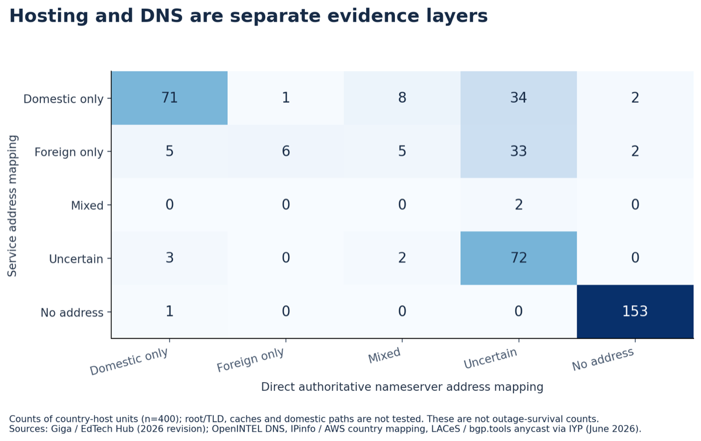

# How countries rely on other countries’ Internet (educational websites)

## Team

- Zuyao Xu, Nankai University

**Contact:** [xuzuyao@mail.nankai.edu.cn](mailto:xuzuyao@mail.nankai.edu.cn) · [@TochusC](https://github.com/TochusC)

## TL;DR

We studied where educational websites and their authoritative DNS servers are hosted across 400 country–hostname pairs. We found that a website hosted domestically can rely on DNS infrastructure abroad.

## Problem

If a country loses international connectivity, can students still reach its educational websites? Even when a website has a domestic address, students need a way to look up that address. We examined where both parts of this lookup were located.

## What we did

We grouped entries in the Giga / EdTech Hub inventory by country and hostname so that multiple pages on the same national portal counted once. We used the Internet Yellow Pages (IYP) to look up website and authoritative nameserver addresses and map them to countries. We also checked existing OONI measurements for 30 selected country–hostname pairs.

## Outcomes

Of the 400 pairs, 116 had website addresses that all mapped to the service country. Among those 116, authoritative DNS addresses mapped only to the same country for 71, only abroad for one, and to both domestic and foreign locations for eight. For the remaining 36, DNS location evidence was uncertain or missing.

The Austrian digital library *digi4school.at* was the one case with domestic website addresses and exclusively foreign DNS addresses. Its observed website addresses mapped to Austria, while its authoritative nameserver addresses mapped to Germany.

## Datasets and tools used

Giga / EdTech Hub supplied the education platform inventory. We queried IYP for OpenINTEL DNS records, IPinfo and AWS location data, and bgp.tools and LACeS anycast evidence. OONI Web Connectivity supplied existing observations from domestic networks.

The research leading to these results was made possible by OpenINTEL (https://www.openintel.nl/), a joint project of the University of Twente, SIDN, NLnet Labs and SURF.

## Project idea

Based on the ISOC Pulse project idea *How Self-Reliant Is a Country’s Internet?*

## Status and next steps

The analysis of existing measurements is complete. The next step is to test whether domestic resolvers can refresh expired DNS records and whether students can complete a learning activity during an international connectivity disruption.

## Links

- [Code: IYP queries](queries/)
- [Presentation and dataset credits (PDF)](presentation.pdf)
